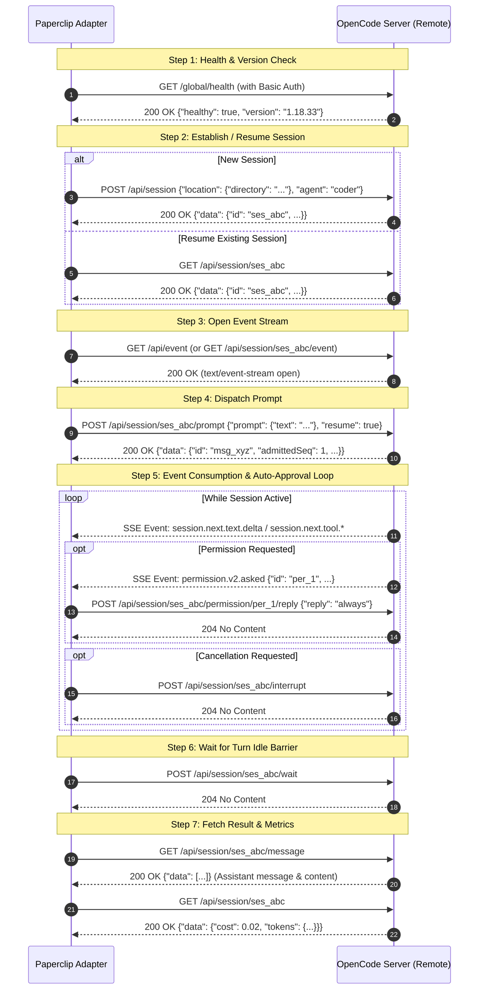

# OpenCode Remote API Specification for Paperclip Adapter

This specification documents the OpenCode server HTTP API for the Paperclip remote adapter (`paperclip-adapter-opencode-remote`). It is derived from the OpenAPI document (`docs-openapi.json`, extracted from OpenCode 1.18.18 via `GET /doc`), public documentation, and observed runtime conventions.

---

## 1. Authentication Scheme

- **OpenAPI Schema Definition:**
  - `components.securitySchemes`: Not defined (`null`) in the OpenAPI schema.
  - Root `security`: Empty list (`[]`).
  - Route error responses: All `/api/...` routes explicitly define `401 UnauthorizedError`:
    ```json
    {
      "_tag": "UnauthorizedError",
      "message": "string"
    }
    ```
- **Observed / Runtime Authentication (unverified from schema alone):**
  - **Transport / Protocol:** HTTP Basic Authentication (`Authorization: Basic <base64(opencode:password)>`).
  - **Username:** `opencode` (fixed string).
  - **Password:** Provided remotely via the `OPENCODE_SERVER_PASSWORD` environment variable.
  - **Missing / Bad Credentials:** Server responds with HTTP status `401 Unauthorized`.

---

## 2. Session Lifecycle

OpenCode sessions represent persistent conversational and execution contexts identified by IDs matching the regex `^ses`.

### 2.1 Create Session
- **Path & Method:** `POST /api/session`
- **OperationId:** `v2.session.create`
- **Request Body (`application/json`):**
  ```json
  {
    "id": "ses_custom_id", // string (optional, pattern: "^ses")
    "agent": "coder", // string (optional)
    "model": { // ModelRef (optional)
      "providerID": "anthropic", // string (required)
      "id": "claude-3-7-sonnet", // string (required)
      "variant": "thinking" // string (optional)
    },
    "location": { // LocationRef (optional)
      "directory": "/workspace/project", // string (required)
      "workspaceID": "wrk_123" // string (optional, pattern: "^wrk")
    }
  }
  ```
- **Response (`200 OK`):**
  ```json
  {
    "data": {
      "id": "ses_123",
      "parentID": "ses_000",
      "projectID": "prj_123",
      "agent": "coder",
      "model": {
        "id": "claude-3-7-sonnet",
        "providerID": "anthropic",
        "variant": "thinking"
      },
      "cost": 0.0,
      "tokens": {
        "input": 0,
        "output": 0,
        "reasoning": 0,
        "cache": { "read": 0, "write": 0 }
      },
      "time": {
        "created": 1740000000000,
        "updated": 1740000000000,
        "archived": null
      },
      "title": "New Session",
      "location": {
        "directory": "/workspace/project",
        "workspaceID": "wrk_123"
      },
      "subpath": "string",
      "revert": null
    }
  }
  ```
- **Errors:** `400 InvalidRequestError`, `401 UnauthorizedError`.

### 2.2 Get Session
- **Path & Method:** `GET /api/session/{sessionID}`
- **OperationId:** `v2.session.get`
- **Path Parameters:** `sessionID` (string, pattern: `^ses`)
- **Response (`200 OK`):** Returns `{"data": SessionV2Info}` (same shape as Create Session response).
- **Errors:** `400 InvalidRequestError`, `401 UnauthorizedError`, `404 SessionNotFoundError`.

### 2.3 List Sessions
- **Path & Method:** `GET /api/session`
- **OperationId:** `v2.session.list`
- **Query Parameters:**
  - `workspace` (string, pattern: `^wrk`)
  - `limit` (number)
  - `order` (`"asc"` | `"desc"`)
  - `search` (string)
  - `directory` (string)
  - `project` (string)
  - `subpath` (string)
  - `cursor` (opaque string cursor)
- **Response (`200 OK`):**
  ```json
  {
    "data": [ /* Array of SessionV2Info */ ],
    "cursor": {
      "previous": "string",
      "next": "string"
    }
  }
  ```

### 2.4 Active Sessions
- **Path & Method:** `GET /api/session/active`
- **OperationId:** `v2.session.active`
- **Description:** Returns foreground session drains currently owned and actively running in the OpenCode process. Sessions not in the map are inactive/idle.
- **Response (`200 OK`):**
  ```json
  {
    "data": {
      "ses_123": {
        "type": "running"
      }
    }
  }
  ```

### 2.5 Resume / Continue a Session
- **Mechanism:** Sessions in OpenCode persist state durably across turns.
  1. Verify the session exists using `GET /api/session/{sessionID}` (`v2.session.get`).
  2. Continue work in that session by issuing a new prompt to `POST /api/session/{sessionID}/prompt` (`v2.session.prompt`).
  3. The `resume` parameter in the prompt request defaults to `true` (unverified default from schema, but schema specifies `"resume": boolean`), which schedules agent-loop execution on the existing session thread.

---

## 3. Sending Work

### 3.1 Route Comparison

| Route | Method | OperationId | Request Body Format | Response Body Format | Blocking Behavior |
|---|---|---|---|---|---|
| `/api/session/{sessionID}/prompt` | `POST` | `v2.session.prompt` | `PromptInput` (simple text, attachments) | `200 OK` with `SessionInputAdmitted` | **Non-blocking (asynchronous admission)**. Durably queues/admits input and schedules agent loop. |
| `/api/session/{sessionID}/message` | `GET` | `v2.session.messages` | *None (GET only)* | `200 OK` with `SessionMessagesResponse` | **Read-only endpoint**. Cannot be used to send work. |
| `/session/{sessionID}/message` *(legacy)* | `POST` | `session.prompt` | `Message` parts (`TextPartInput`, etc.) + `model` + `agent` | `200 OK` with `AssistantMessage` + `parts` | **Blocking**. Streams or blocks until complete turn response is produced. |
| `/session/{sessionID}/prompt_async` *(legacy)* | `POST` | `session.prompt_async` | Same as legacy `/session/{id}/message` | `204 No Content` | **Non-blocking**. Starts session if needed and returns immediately. |

### 3.2 `POST /api/session/{sessionID}/prompt` (`v2.session.prompt`)
- **Request Body (`application/json`):**
  ```json
  {
    "id": "msg_0123456789", // string (optional, pattern: "^msg_")
    "prompt": {
      "text": "Run tests and fix failures", // string (required)
      "files": [ // optional PromptInputFileAttachment array
        {
          "uri": "file:///path/to/file", // required
          "name": "string",              // optional
          "description": "string",       // optional
          "source": {}                   // optional
        }
      ],
      "agents": [ // optional PromptAgentAttachment array
        {
          "agent": "coder"
        }
      ]
    },
    "delivery": "steer", // "steer" | "queue" (optional)
    "resume": true // boolean (optional, schedules agent execution)
  }
  ```
- **Response Body (`200 OK`):**
  ```json
  {
    "data": {
      "admittedSeq": 1,
      "id": "msg_0123456789",
      "sessionID": "ses_123",
      "prompt": {
        "text": "Run tests and fix failures"
      },
      "delivery": "steer",
      "timeCreated": 1740000000000,
      "promotedSeq": 1
    }
  }
  ```

### 3.3 How to Pick Model and Agent
Under the `/api/...` routes, the prompt request body (`PromptInput`) does not accept arbitrary model overrides. Instead:
- **Set at Creation:** Pass `model` (`ModelRef`) and `agent` (string) in `POST /api/session` (`v2.session.create`).
- **Dynamic Model Switching:**
  - **Path:** `POST /api/session/{sessionID}/model`
  - **OperationId:** `v2.session.switchModel`
  - **Body:**
    ```json
    {
      "model": {
        "providerID": "anthropic",
        "id": "claude-3-7-sonnet",
        "variant": "thinking" // optional
      }
    }
    ```
  - **Response:** `204 No Content`.
- **Dynamic Agent Switching:**
  - **Path:** `POST /api/session/{sessionID}/agent`
  - **OperationId:** `v2.session.switchAgent`
  - **Body:** `{"agent": "coder"}`
  - **Response:** `204 No Content`.
- **Discovering Available Models & Agents:**
  - `GET /api/model` (`v2.model.list`): Lists models with provider IDs, capabilities, context limits, and variants.
  - `GET /api/agent` (`v2.agent.list`): Lists available agent configurations, modes (`primary`, `subagent`, `all`), and permission rulesets.

---

## 4. Events & Streaming

OpenCode publishes events over Server-Sent Events (SSE).

### 4.1 Event Endpoints

1. **`GET /api/event` (`v2.event.subscribe`):**
   - **Transport:** SSE (`Content-Type: text/event-stream`).
   - **Scope:** Server-wide native event stream.
   - **Schema:** Emits `V2Event` union payloads.
   - **Includes:** Both durable state events and transient streaming deltas (`session.next.text.delta`, `session.next.tool.input.delta`, `session.idle`, `session.status`, `permission.v2.asked`, etc.).
2. **`GET /api/session/{sessionID}/event` (`v2.session.events`):**
   - **Transport:** SSE (`Content-Type: text/event-stream`), header/annotation `x-effect-stream: sse`.
   - **Parameters:** `after` (optional query string: aggregate sequence cursor).
   - **Scope:** Session-scoped durable event replay and live tail.
   - **Schema:** Stream of `SessionDurableEvent`.
   - **Important Distinction:** Replays durable lifecycle milestones (`session.next.step.*`, `session.next.text.started`, `session.next.text.ended`, `session.next.tool.called`, `session.next.tool.success`, etc.). **Does NOT contain fine-grained character deltas** (`*.delta`).
3. **`GET /event` (`event.subscribe`):**
   - **Transport:** SSE (`text/event-stream`).
   - **Legacy:** Accepts query parameters `directory` and `workspace`. Schema is `Event`.

### 4.2 Turn Finished and Session Idle Signals

There are two distinct completion levels to monitor:
1. **Turn / Step Ended:**
   - Event `type`: `"session.next.step.ended"` (`SessionNextStepEnded`)
   - Emitted when an individual model turn step completes.
   - Payload `data`:
     ```json
     {
       "sessionID": "ses_123",
       "assistantMessageID": "msg_assistant_1",
       "timestamp": 1740000000000,
       "finish": "stop", // string: finish reason (e.g., "stop", "tool_calls")
       "cost": 0.015,
       "tokens": {
         "input": 1200,
         "output": 350,
         "reasoning": 0,
         "cache": { "read": 500, "write": 0 }
       },
       "snapshot": "hash",
       "files": ["file1.txt"]
     }
     ```
2. **Agent Loop Complete / Session Idle:**
   - Event `type`: `"session.idle"` (`SessionIdle`)
     - Payload `data`: `{"sessionID": "ses_123"}`
     - Indicates the entire multi-step agent loop has finished all tool executions and has settled into an idle state.
   - Event `type`: `"session.status"` (`session.status`)
     - Emitted when session status transitions.
     - Payload `data`: `{"sessionID": "ses_123", "status": {"type": "idle"}}` (status can be `"idle"`, `"busy"`, or `"retry"`).

### 4.3 Text Deltas and Tool Calls

- **Text Streaming:**
  - Start: `session.next.text.started` -> `{ "sessionID": "ses_123", "assistantMessageID": "msg_1", "textID": "txt_1" }`
  - Delta: `session.next.text.delta` -> `{ "sessionID": "ses_123", "assistantMessageID": "msg_1", "textID": "txt_1", "delta": "word " }`
  - Completion: `session.next.text.ended` -> `{ "sessionID": "ses_123", "assistantMessageID": "msg_1", "textID": "txt_1", "text": "complete output" }`
  - Legacy delta: `message.part.delta` -> `{ "sessionID": "ses_123", "messageID": "msg_1", "partID": "prt_1", "field": "text", "delta": "word " }`
- **Tool Invocations:**
  - Streaming tool input: `session.next.tool.input.delta` -> `{ "callID": "call_1", "delta": "{\"arg\":" }`
  - Tool dispatched: `session.next.tool.called` -> `{ "callID": "call_1", "tool": "bash", "input": {"command": "ls -la"}, "provider": {"executed": false} }`
  - Tool progress: `session.next.tool.progress` -> `{ "callID": "call_1", "structured": {}, "content": [] }`
  - Tool success: `session.next.tool.success` -> `{ "callID": "call_1", "structured": {}, "content": [...], "result": ... }`
  - Tool failure: `session.next.tool.failed` -> `{ "callID": "call_1", "error": {...} }`

---

## 5. Cancelling Work

- **Path & Method:** `POST /api/session/{sessionID}/interrupt`
- **OperationId:** `v2.session.interrupt`
- **Path Parameters:** `sessionID` (pattern: `^ses`)
- **Request Body:** None (`null`).
- **Response (`204 No Content`):** Execution is interrupted. Intercepting an idle session is a safe no-op.
- **Errors:** `400 InvalidRequestError`, `401 UnauthorizedError`, `404 SessionNotFoundError`.
- **Legacy Equivalent:** `POST /session/{sessionID}/abort` (`session.abort`), which accepts `directory` and `workspace` query params and returns `200 boolean`.

---

## 6. Waiting for Session Turn Completion

- **Path & Method:** `POST /api/session/{sessionID}/wait`
- **OperationId:** `v2.session.wait`
- **Path Parameters:** `sessionID` (pattern: `^ses`)
- **Request Body:** None (`null`).
- **Response (`204 No Content`):** The HTTP request blocks server-side until the session's active agent loop finishes and transitions to idle.
- **Errors:** `400 InvalidRequestError`, `401 UnauthorizedError`, `404 SessionNotFoundError`, `503 ServiceUnavailableError`.
- **Usage Recommendation:** When streaming SSE events over `/api/event`, `v2.session.wait` serves as a reliable secondary barrier or timeout check to guarantee turn completion.

---

## 7. Reading Final Results, Token Usage, and Cost

### 7.1 Aggregate Session Cost and Tokens
- **Path & Method:** `GET /api/session/{sessionID}` (`v2.session.get`)
- **Data Extracted (`data.tokens` and `data.cost`):**
  ```json
  {
    "cost": 0.0432,
    "tokens": {
      "input": 3200,
      "output": 840,
      "reasoning": 128,
      "cache": {
        "read": 1600,
        "write": 0
      }
    }
  }
  ```

### 7.2 Final Turn Output & Assistant Messages
- **Path & Method:** `GET /api/session/{sessionID}/message`
- **OperationId:** `v2.session.messages`
- **Query Parameters:** `cursor` (optional pagination cursor).
- **Response (`200 OK`):**
  ```json
  {
    "data": [
      {
        "type": "assistant",
        "id": "msg_assistant_1",
        "agent": "coder",
        "model": {
          "id": "claude-3-7-sonnet",
          "providerID": "anthropic"
        },
        "content": [
          {
            "type": "text",
            "id": "txt_1",
            "text": "The tests have passed successfully."
          },
          {
            "type": "tool",
            "id": "tool_1",
            "name": "bash",
            "state": {
              "status": "completed",
              "input": { "command": "pytest" },
              "content": [ { "type": "text", "text": "1 passed" } ],
              "structured": {}
            },
            "time": { "created": 1740000000000, "ran": 1740000000100, "completed": 1740000000500 }
          }
        ],
        "finish": "stop",
        "cost": 0.021,
        "tokens": {
          "input": 1500,
          "output": 400,
          "reasoning": 0,
          "cache": { "read": 800, "write": 0 }
        },
        "time": {
          "created": 1740000000000,
          "completed": 1740000005000
        }
      }
    ],
    "cursor": {
      "previous": null,
      "next": null
    }
  }
  ```
- Alternatively, retrieve an exact message: `GET /api/session/{sessionID}/message/{messageID}` (`v2.session.message`).

---

## 8. Permissions and Question Requests (Unattended Run Handling)

During unattended automated runs, tool permission requests or user clarification questions will pause agent execution until resolved.

### 8.1 Permission Requests
When a tool execution requires confirmation, OpenCode creates a permission request and emits event `permission.v2.asked` (`PermissionV2Asked`).

- **List Session Permissions:** `GET /api/session/{sessionID}/permission` (`v2.session.permission.list`) or server-wide `GET /api/permission/request` (`v2.permission.request.list`).
  - Item fields: `id` (pattern: `^per`), `sessionID`, `action`, `resources`.
- **Auto-Resolve (Approve or Deny):**
  - **Path:** `POST /api/session/{sessionID}/permission/{requestID}/reply`
  - **OperationId:** `v2.session.permission.reply`
  - **Request Body:**
    ```json
    {
      "reply": "always", // "once" | "always" | "reject" (required)
      "message": "Auto-approved by Paperclip adapter" // string (optional)
    }
    ```
  - **Response:** `204 No Content`.
- **Legacy Route Equivalent:**
  - `POST /permission/{requestID}/reply` (`permission.reply`) with `{"reply": "always"}`.
  - `POST /session/{sessionID}/permissions/{permissionID}` (`permission.respond`) with `{"response": "always"}`.

### 8.2 Question Requests
When an agent asks a question, OpenCode emits `question.v2.asked` (`QuestionV2Asked`).

- **List Session Questions:** `GET /api/session/{sessionID}/question` (`v2.session.question.list`) or server-wide `GET /api/question/request` (`v2.question.request.list`).
  - Item fields: `id` (pattern: `^que`), `sessionID`, `questions` (array of `QuestionV2Info` containing `question`, `header`, `options`).
- **Auto-Resolve via Reply:**
  - **Path:** `POST /api/session/{sessionID}/question/{requestID}/reply`
  - **OperationId:** `v2.session.question.reply`
  - **Request Body:**
    ```json
    {
      "answers": [
        ["FirstOptionLabel"] // Array of selected label strings per question
      ]
    }
    ```
  - **Response:** `204 No Content`.
- **Auto-Resolve via Reject:**
  - **Path:** `POST /api/session/{sessionID}/question/{requestID}/reject`
  - **OperationId:** `v2.session.question.reject`
  - **Request Body:** None (`null`).
  - **Response:** `204 No Content`.

---

## 9. Health Check and Version Endpoints

For connectivity, credential verification, and environment validation:

### 9.1 `GET /api/health` (`v2.health.get`)
- **Summary:** Check server health and API readiness.
- **Request Parameters:** None.
- **Response (`200 OK`):**
  ```json
  {
    "healthy": true
  }
  ```
- **Error Responses:**
  - `401 UnauthorizedError`: Emitted if HTTP Basic Auth fails or is missing.
- **Limitation:** Does **not** include server version in the schema response.

### 9.2 `GET /global/health` (`global.health`)
- **Summary:** Get health and version information about the OpenCode server.
- **Request Parameters:** None.
- **Response (`200 OK`):**
  ```json
  {
    "healthy": true,
    "version": "1.18.18"
  }
  ```
- **Usage Recommendation:** The adapter environment check should call `GET /global/health` to extract the exact server version string while validating connectivity and credentials.

---

## 10. Differences: Legacy Unprefixed Routes vs `/api/...` Routes

### 10.1 Key Architectural Differences

| Feature | Legacy Unprefixed Routes (`session.*`, `event.*`) | New V2 Routes (`/api/...`, `v2.*`) |
|---|---|---|
| **Namespace** | Root-level paths (`/session`, `/event`, `/permission`, `/question`, `/global/health`) | Organized under `/api/` (`/api/session`, `/api/event`, `/api/health`, `/api/model`) |
| **Framework & Error Model** | Legacy route handlers, errors like `BadRequestError`, `NotFoundError` | Built on Effect-ts HTTP API; strongly typed errors with `_tag` (`InvalidRequestError`, `SessionNotFoundError`, `UnauthorizedError`) |
| **Message Dispatch** | Synchronous blocking (`POST /session/{id}/message`) or fire-and-forget (`POST /session/{id}/prompt_async`) | Durable admission (`POST /api/session/{id}/prompt`) returning immediately with sequence tracker |
| **Wait Primitive** | None. Client must hold connection open on `POST .../message` or poll `/session/status` | Explicit `POST /api/session/{id}/wait` returning `204` when agent loop becomes idle |
| **Session Scoping** | Permissions and questions are mostly global (`/permission`, `/question`) | Scoped explicitly to session (`/api/session/{id}/permission`, `/api/session/{id}/question`) |
| **Event Streams** | Single global `/event` stream | Both per-session durable replay (`/api/session/{id}/event?after=...`) and server-wide live bus (`/api/event`) |

### 10.2 Which Set the Adapter Should Use
**The adapter must use the `/api/...` (v2) routes.**
- **Reasoning:**
  1. **Clean Asynchronous Design:** Input submission (`POST .../prompt`), execution waiting (`POST .../wait`), and streaming (`GET .../event`) are distinct, decoupled operations.
  2. **Reliable Cancellation:** `POST /api/session/{sessionID}/interrupt` is standardized and returns immediately without query parameter ambiguity.
  3. **Multi-tenant / Session Isolation:** Permissions and questions can be filtered and replied to strictly within the target `sessionID`, preventing cross-session interference on shared servers.
  4. **Exception:** Server version discovery should use `GET /global/health` as `/api/health` does not return the version string in 1.18.18.

---

## 11. Considerations for OpenCode 1.18.33 Remote Servers

The OpenAPI specification in `docs-openapi.json` is generated from OpenCode **1.18.18**. Remote servers run **1.18.33**.

### Expected or Potential Differences:
1. **Server Version String:** `GET /global/health` will return `"version": "1.18.33"` instead of `"1.18.18"`.
2. **Version Field in `/api/health` (*unverified from schema*):** Newer versions of OpenCode may add the `version` field directly to `/api/health`.
3. **Additional Event Types (*unverified from schema*):** Between 1.18.18 and 1.18.33, new event types or additional metadata fields on `SessionDurableEvent` or `V2Event` may be introduced. The adapter's SSE parser must ignore unrecognized event types without erroring.
4. **Agent & Model Catalog (`GET /api/model`, `GET /api/agent`):** Model capabilities, default variant names (e.g., thinking budgets), and agent permissions may differ based on provider updates.
5. **Legacy Route Deprecation (*unverified from schema*):** Legacy unprefixed endpoints (`/session/...`, `/event`) may be deprecated or subject to removal in newer releases, confirming the necessity of targeting `/api/...`.

---

## 12. Minimal Adapter Call Sequence

The exact ordered sequence of HTTP requests for one execution turn (`execute()`) in the Paperclip remote adapter:



### Detailed Request Breakdown:

1. **Environment & Health Validation:**
   - `GET /global/health`
   - Headers: `Authorization: Basic <base64(opencode:password)>`
   - Verify `healthy == true` and capture `version`.

2. **Session Initialization or Resolution:**
   - If starting fresh:
     - `POST /api/session`
     - Headers: `Authorization: Basic ...`, `Content-Type: application/json`
     - Body: `{"location": {"directory": "/path/to/workdir"}, "agent": "coder"}`
     - Extract `sessionID = response.data.id`.
   - If resuming:
     - `GET /api/session/{sessionID}`
     - Ensure session exists and is accessible.

3. **Open Event Stream (SSE):**
   - `GET /api/event` (or `GET /api/session/{sessionID}/event`)
   - Headers: `Authorization: Basic ...`, `Accept: text/event-stream`
   - Keep connection open in a listener thread/task to stream logs (`session.next.text.delta`, `session.next.tool.*`).

4. **Send Prompt Input:**
   - `POST /api/session/{sessionID}/prompt`
   - Headers: `Authorization: Basic ...`, `Content-Type: application/json`
   - Body:
     ```json
     {
       "prompt": {
         "text": "Your task instructions..."
       },
       "resume": true
     }
     ```
   - Validates that the prompt is admitted (`SessionInputAdmitted`).

5. **Monitor Turn & Handle Blocks:**
   - Read SSE events:
     - Forward `session.next.text.delta` as agent output logs.
     - Forward `session.next.tool.called` / `session.next.tool.progress` / `session.next.tool.success` as tool execution logs.
     - If `permission.v2.asked` arrives:
       - Auto-reply: `POST /api/session/{sessionID}/permission/{requestID}/reply` with `{"reply": "always"}`.
     - If user cancels turn:
       - Issue cancel: `POST /api/session/{sessionID}/interrupt`.
     - Stop reading stream when `session.idle` event is received (or `session.status` reports `"idle"`).

6. **Wait Barrier:**
   - Call `POST /api/session/{sessionID}/wait` (blocks until agent loop reaches idle state; returns `204`).

7. **Collect Turn Artifacts & Usage Metrics:**
   - `GET /api/session/{sessionID}/message`:
     - Inspect the last message where `type == "assistant"`.
     - Extract text from content array (`type == "text"`) as final turn response.
     - Inspect `finish` reason (e.g. `stop`, `aborted`, `error`).
   - `GET /api/session/{sessionID}`:
     - Extract cumulative `cost` and `tokens` (`input`, `output`, `reasoning`, `cache.read`, `cache.write`).


---
Reviewed against docs-openapi.json: all cited operation IDs and event type names exist; the prompt body fields (`id`, `prompt`, `delivery`, `resume`) match the schema; file attachment shape corrected to `uri`-based. Runtime behaviour (SSE framing, ordering) is unverified from the schema.
